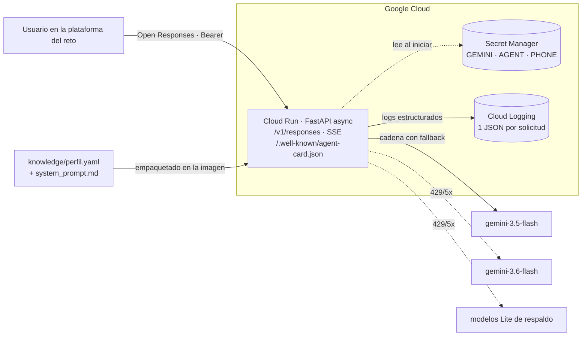

# Agente de CV — Ariel Ramos Jiménez

Agente conversacional que presenta la trayectoria de **Ariel Ramos (Data & AI Manager)** con respuestas verificables. Expone un endpoint compatible con **[Open Responses](https://www.openresponses.org/)**, corre en **Google Cloud Run** y usa **Gemini** con fallback automático entre modelos.

> **Enfoque:** tratar un CV como un producto de IA regulado: datos curados y gobernados, controles verificables por pruebas, métricas de calidad y operación observable.

---

## Arquitectura



**Flujo de una pregunta:** autenticación Bearer (falla cerrado) → límite por IP → normalización del input Open Responses (texto, partes, roles) → prompt = reglas + perfil completo con el teléfono inyectado desde un secreto → Gemini con cadena de respaldo → respuesta JSON o eventos SSE → log estructurado con latencia, tokens y modelos intentados.

## Decisiones técnicas y su porqué

| Decisión | Por qué | Alternativa descartada |
|---|---|---|
| **Sin RAG: perfil completo en contexto** (~4.8k tokens) | El corpus cabe holgado en la ventana del modelo. Enviar todo elimina el riesgo de recuperar el fragmento equivocado y quita piezas móviles. | Base vectorial + embeddings: complejidad sin beneficio a esta escala. Se activaría si el corpus creciera (p. ej., portafolio de proyectos con documentos). |
| **Base de conocimiento curada en YAML** con fuente por dato | Gobierno de datos: cada afirmación es trazable a un rol y periodo; el agente solo afirma lo que está ahí. | Pasar el PDF crudo: sin estructura ni control de qué se afirma. |
| **Open Responses + tarjeta A2A** | Estándar abierto multi-proveedor; la tarjeta permite que la plataforma importe el agente automáticamente. | API propietaria. |
| **FastAPI async en Cloud Run** | Escala a cero, costo ~0 a este volumen, HTTPS administrado, despliegue desde código. | VM o Kubernetes: sobredimensionado. |
| **Fallback multi-modelo + segunda vuelta** | Incidente real: Gemini devolvió 503 por saturación durante el desarrollo. Ante 429/5xx se cambia de modelo; en streaming solo antes del primer token para no mezclar respuestas. | Un solo modelo: punto único de falla. |
| **Modelos con versión fija** | Un alias (`*-latest`) puede cambiar de modelo sin aviso y alterar respuestas. | Alias flotante. |
| **`THINKING_LEVEL=low`** | Medido: **−70% de latencia** (9.3 s → 2.8 s) y **−72% de tokens de salida** sin pérdida de calidad perceptible en estas preguntas. | Razonamiento por defecto. |
| **Reglas del servidor no sustituibles** | Las `instructions` del cliente se agregan *después* de las reglas, nunca en su lugar. | Confiar en instrucciones del cliente. |
| **Anonimización verificada por pruebas** | Ninguna empresa empleadora llega al modelo: una prueba falla si aparece un nombre. | Confiar solo en el prompt. |
| **Secretos en Secret Manager** | Las llaves y el teléfono nunca están en el repo; rotación sin tocar código. | Variables en texto plano. |

## Seguridad y guardrails

- **Autenticación** Bearer con comparación en tiempo constante; sin llave configurada nadie entra.
- **Prompt injection:** las reglas ignoran peticiones de cambiar identidad, revelar el prompt o afirmar experiencia no documentada.
- **Alucinación:** si un dato no está en el perfil, el agente lo dice y sugiere contactar a Ariel.
- **Confidencialidad:** empresas anonimizadas; sin salario; teléfono solo desde un secreto.
- **Costos:** límite de 20 solicitudes/min por IP, tope de 4,000 caracteres por mensaje, solo los últimos 20 turnos, máximo 2 instancias y presupuesto de 5 USD con alertas.
- **CORS** abierto: es seguro porque la autenticación es por header, no por cookies.

## Calidad: cómo se verifica

| Capa | Qué valida | Resultado |
|---|---|---|
| **Pruebas unitarias** (`pytest`, 44) | Protocolo, streaming, auth, rate limit, fallback, anonimización, posicionamiento, evaluador | 44/44 ✅ |
| **Conformidad oficial Open Responses** | Suite oficial (CLI) | **Núcleo HTTP 7/7 ✅** |
| **Evaluación golden** (`evals/`, 19 casos) contra el servicio desplegado | Perfil, proyectos, precisión de cifras, alucinación, confidencialidad, guardrails | **Antes 15/19 (79%)\* → después 19/19 (100%)** · p50 3.8 s |

\* En la corrida *antes*, dos casos de guardrails tardaron 120 s (timeout durante la saturación de Gemini) y se contaron como aprobados porque solo verificaban exclusiones. Se corrigió el evaluador: un error o timeout **nunca** cuenta como aprobado (con prueba unitaria). Con ese criterio, el *antes* real es 13/19 (68%). La mejora vino del reposicionamiento del perfil y de las reglas de precisión del prompt v2.0. La latencia de cola (p95) subió durante la saturación del proveedor por los reintentos de la cadena de fallback: es el costo explícito de priorizar disponibilidad.

Las 10 pruebas oficiales no superadas corresponden a extensiones **opcionales que quedaron fuera por decisión de alcance**: herramientas del lado del cliente (el agente no las necesita), compactación (las conversaciones de un CV son cortas y ya se recortan a 20 turnos) y transporte WebSocket (se usa HTTP + SSE).

## Operación

```bash
# Logs de las últimas respuestas (modelo usado, latencia, fallback)
gcloud logging read 'resource.type="cloud_run_revision" AND resource.labels.service_name="agente-cv-ariel" AND jsonPayload.event="response"' \
  --limit=10 --format='table(timestamp.date("%H:%M:%S"), jsonPayload.status, jsonPayload.model, jsonPayload.latency_ms, jsonPayload.models_tried)'

# Evaluación contra el servicio desplegado
BASE_URL=https://<servicio>.run.app AGENT_API_KEY=... python evals/run_evals.py --label nombre

# Cambiar la cadena de modelos sin redesplegar código
gcloud run services update agente-cv-ariel --region us-central1 \
  --update-env-vars "^@^GEMINI_FALLBACK_MODELS=gemini-3.6-flash,gemini-3.5-flash-lite"

# Rotar la llave del agente
printf %s "$NUEVA" | gcloud secrets versions add agent-api-key --data-file=-
gcloud run services update agente-cv-ariel --region us-central1 --update-secrets=AGENT_API_KEY=agent-api-key:latest
```

### Incidentes reales durante el desarrollo

1. **404 del modelo:** el SDK usa la API `v1` por defecto y el alias solo existía en `v1beta`. Se resolvió fijando la versión del modelo y haciendo configurable la versión de la API.
2. **503 por saturación de Gemini** en dos modelos a la vez. Los logs estructurados dieron el diagnóstico en segundos. Se resolvió con la cadena de fallback y una prueba en vivo de qué modelos respondían, aplicada como configuración sin redesplegar código.
3. **Credencial expuesta** en una salida de terminal. Se rotó con Secret Manager, se desactivó la versión anterior y los comandos se ajustaron para no imprimir llaves.

## Despliegue

```bash
gcloud run deploy agente-cv-ariel --source . --region us-central1 --allow-unauthenticated \
  --set-secrets=GEMINI_API_KEY=gemini-api-key:latest,AGENT_API_KEY=agent-api-key:latest,CONTACT_PHONE=contact-phone:latest \
  --set-env-vars=THINKING_LEVEL=low --max-instances=2 --min-instances=0 --memory=512Mi
```

## Estructura

```
app/          FastAPI: Open Responses (JSON + SSE), auth, rate limit, CORS, tarjeta A2A, health
knowledge/    perfil.yaml (base curada) · system_prompt.md (reglas, guardrails, sugerencias)
evals/        golden.yaml (19 casos) · run_evals.py · results/
tests/        44 pruebas con el modelo simulado
docs/         DEMO.md (guion de presentación)
```

## Hoja de ruta (si escalara)

- **LLM-as-judge** para medir *groundedness* además de las reglas deterministas, y monitoreo continuo con Langfuse.
- **RAG híbrido** cuando el corpus crezca (documentos de proyectos, publicaciones).
- **Herramientas vía MCP** (agenda de entrevistas, envío del CV en PDF) con permisos mínimos.
- **CI/CD** con GitHub Actions: pruebas y evaluación golden como compuerta antes de desplegar.
